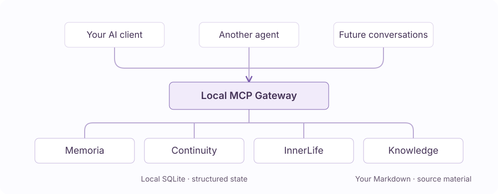

<p align="center">
  
</p>

<h1 align="center">Keep the thread. Across conversations.</h1>

<p align="center">A local memory and continuity workspace for your AI agents.</p>

<p align="center">
  <a href="https://xiaomao361.github.io/claracore-desktop/">Website</a> ·
  <a href="https://github.com/xiaomao361/claracore-desktop/releases/latest">Download</a> ·
  <a href="docs/README.md">Documentation</a> ·
  <a href="README.zh-CN.md">简体中文</a>
</p>

<p align="center">
  
</p>

ClaraCore Desktop gives the agents you use a shared place to remember what
matters and pick up where work left off. It runs on your computer, stores
structured data in SQLite, and connects to MCP clients through a local Gateway.

It is a companion to your existing AI clients. Bring the agent and model you
prefer; keep memories, project context, and source material in a workspace you
control.

## What it keeps

| Area | Purpose |
| --- | --- |
| **Memoria** | Confirmed facts, preferences, decisions, and relationships between memories. |
| **Continuity** | Shared Lines: the current position, evidence, and next step of a resumable goal. |
| **InnerLife** | Optional reflections and suggestions, reviewed separately from confirmed facts. |
| **Knowledge** | Your Markdown source material, with section links, attribution, and explicit search. |

The Gateway gives agents bounded context by default. They can request a
specific memory, line, or source section when they need more detail.



## Download

The current release is **1.0.6**. Choose **Full** for an included local embedding
model, or **Lite** to configure Ollama or an OpenAI-compatible Memory embedding
API, or work without embeddings. Knowledge semantic search stays local.

| Build | macOS Apple Silicon | Windows x64 |
| --- | --- | --- |
| Full | [Download DMG](https://github.com/xiaomao361/claracore-desktop/releases/download/v1.0.6/ClaraCore-Desktop-1.0.6-arm64.dmg) | [Download installer](https://github.com/xiaomao361/claracore-desktop/releases/download/v1.0.6/ClaraCore-Desktop-1.0.6-x64-Setup.exe) |
| Lite | [Download DMG](https://github.com/xiaomao361/claracore-desktop/releases/download/v1.0.6/ClaraCore-Desktop-1.0.6-lite-arm64.dmg) | [Download installer](https://github.com/xiaomao361/claracore-desktop/releases/download/v1.0.6/ClaraCore-Desktop-1.0.6-lite-x64-Setup.exe) |

macOS packages are signed and notarized. Windows installers are unsigned.
Checksums and changes are available on the [release page](https://github.com/xiaomao361/claracore-desktop/releases/tag/v1.0.6).
Prebuilt Linux and Intel Mac installers are not currently provided.

## In 1.0.6

- Read focused pages and settings, with clearer connection and recall evidence.
- Search and switch agents without stale results; page through Shared Lines and
  share history, and read original InnerLife text by record.
- Keep operation success distinct from refresh failure, and retain readable
  Knowledge entries when another document fails.

See the [changelog](CHANGELOG.md) and [release record](docs/RELEASE_1.0.6.md).

## Get started

1. Install and open ClaraCore Desktop.
2. Open **Agent Access** and copy the connection configuration for your client.
3. Connect your MCP client and call `claracore_connection_test`.
4. Ask your agent to recall a memory or resume a specific Shared Line.

Keep Desktop running while your agents are connected. The default MCP endpoint
is `http://127.0.0.1:50668/mcp`; use the URL and token shown in your installation.
See [Getting started](docs/GETTING_STARTED.md) for setup and troubleshooting.

## Local data, explicit connections

Memories and project state live in a Desktop-owned SQLite database. Knowledge
files remain in the Markdown directory you select. Embeddings can run locally;
optional model providers receive the requests you configure. MCP clients also
receive the context they request. See [Privacy and data](docs/PRIVACY.md) before
connecting a provider or sharing a backup.

Automatic context depends on the host client's integration. Connecting MCP
alone does not install hooks or capture all conversations. InnerLife is
optional and does not automatically turn generated thoughts into memories.

## Develop

Use Node.js 22 and npm:

```sh
npm ci
npm run check
npm run start:next
```

`start:next` opens an isolated development instance. For non-interactive work,
`npm run check` runs source and isolated core checks. Some other test commands
open Electron windows; see [Contributing](CONTRIBUTING.md) before running them.

The desktop renderer uses plain JavaScript, HTML, and CSS. The core is Node.js
with SQLite; packaging uses Electron Builder. The website is static HTML/CSS/JS
and deploys through GitHub Pages.

## Contribute and learn more

- [Contributing](CONTRIBUTING.md): development, tests, and pull requests.
- [Architecture](docs/ARCHITECTURE.md) and [code map](docs/CODE_MAP.md): where changes belong.
- [Agent integration](docs/AGENT_MCP_PLAYBOOK.md): identity, context, and tool profiles.
- [Changelog](CHANGELOG.md): release highlights.
- [Security](SECURITY.md): reporting a vulnerability without exposing private data.

Bug reports and focused pull requests are welcome through
[GitHub Issues](https://github.com/xiaomao361/claracore-desktop/issues) and
[Pull Requests](https://github.com/xiaomao361/claracore-desktop/pulls).

## License

[MIT](LICENSE). Third-party dependencies and bundled models retain their own licenses.
