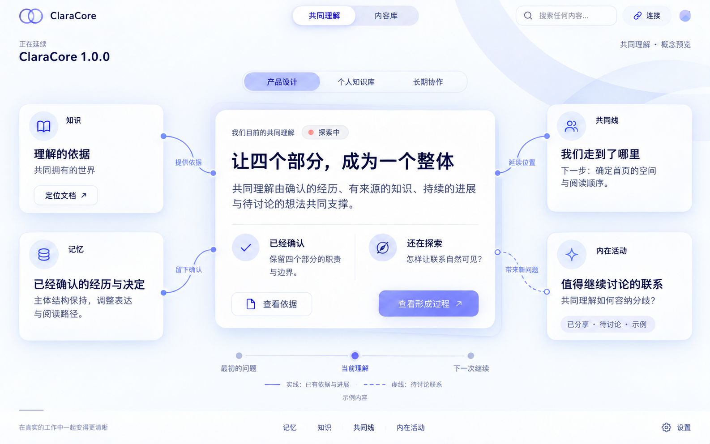

# 1.0.0 共同理解：产品与视觉方向交接

日期：2026-10-14。状态：方向讨论完成一个阶段，视觉仍需优化，尚未形成实现规格或发版验收。

来源 chat：`01a1398f-004a-7e33-94d0-769fa54d545f`。

## 从这里继续

用户希望正式发布 1.0.0，但目前难以向别人解释用途，界面也缺少辨识度。本轮找到了统一的产品中心，并通过多轮概念图探索，选中了白色、淡紫、轻盈层次与细线关联的方向。

用户最新反馈：“这个感觉差不多了，可以再优化下设计”。下一会话应沿此方向优化设计、讨论真实使用方式；不要重新从通用管理后台或完全不同的风格开始，也不要直接修改产品代码。

## 已确认的产品方向

ClaraCore 维护人与 AI 逐渐形成的共同理解，使下一次交流能从已有基础继续。

“共同理解”包含共同经历、参考资料、确认的事实与决定、当前进展，以及彼此知道但仍未解决的问题和分歧。“共识”只是其中达成一致的部分，不能把所有理解都写成已经同意。

记忆、知识、共同线、内在活动共同支撑这份理解。主体结构和四个部分的职责基本保留；共同理解是统一的产品中心，不必再建成第五个独立业务模块。

| 部分 | 对共同理解的贡献 | 保留的语义边界 |
| --- | --- | --- |
| 知识 | 提供可以再次阅读、讨论、核验的依据 | 来源材料及解释不等于用户立场 |
| 记忆 | 保留重要经历、事实、偏好和确认的决定 | AI 推测不能冒充用户确认 |
| 共同线 | 保留当前位置、未决问题与下一次起点 | 选择阅读对象不等于激活或重排 |
| 内在活动 | 形成值得讨论的新联系与想法 | 念头保持待核实；不自动转成共识、记忆或知识 |

核心阅读路径：看见共同关心的事 → 读懂当前理解 → 查看依据、经历和变化 → 知道从哪里继续。

## 当前视觉基线

此图由内置 imagegen 生成，属于概念预览。文字、记录、关联、状态和控件均是示意；不是运行截图，也不证明相关接口已存在或交互已完成。

原始文件：`/Users/zhouwei/.codex/generated_images/01a1398f-004a-7e33-94d0-769fa54d545f/exec-4d037859-ea54-45af-8207-13100dce26d9.png`。本仓库副本可供后续会话直接读取。

用户选定的视觉特点：

- 白色、淡紫、冰蓝的轻盈色彩，深色正文；柔和层次与适量阴影。
- 中间是当前共同理解，周围是四个模块提供的相关内容。
- 细线关联四个部分与共同理解，表达它们共同组成整体。
- 顶部轻量导航、主题选择和搜索；内容先于运行状态与技术配置。

## 需要保留与继续优化的区别

保留的是配色气质、空间层次、共同理解的中心位置，以及四个部分有联系的表达。尚未确认具体字号、尺寸、卡片形状、图标、动效、连线路由、导航层级或窄窗口方案。

下一轮重点建议：

1. 降低“中心卡片＋四张等大卡片”的架构图感。外围优先显示与主题相关的真实内容摘要，模块身份成为辅助标签。
2. 中间标题改为当前主题的具体理解，而非长期保留“让四个部分成为一个整体”这类设计口号。
3. 连线必须对应可说明的联系，例如提供依据、留下确认、延续位置、提出问题；保证端点清晰，不穿过正文，不以相似度冒充确认的关系。
4. 降低重复的大图标和胶囊控件重量，提高正文对比度，完善标题、说明、状态、操作的层级。
5. 探索选择或聚焦一个内容时怎样展开依据与变化；此处是交互设计议题，不是已授权实现的动作。
6. 定义内容增长后的阅读方式：有限预览、单一完整阅读层、明确继续读取入口。避免为了四个模块齐全而填入无关内容。
7. 设计无数据、无关联、多主题、长正文和窄窗口状态。四个部分共同构成能力，但每个主题不一定都有四类内容。

图中实线表示已建立的依据或进展联系，虚线表示待讨论联系。这是视觉提案，尚不是完成的数据契约。不能把知识正确性、关联存在和用户同意混为同一种状态；必要时端点状态与关系标签分别表达。

图中的内在活动为“已分享、待讨论”的示例。首页不提前展示私有、尚未分享的念头；有适合当前主题且允许展示的内容时才出现具体预览。

## 已讨论的全局改造方向

- 首页围绕当前共同理解组织，运行状态收为辅助信息，影响使用的错误仍需清楚可见。
- 记忆、知识、共同线、内在活动的内容页面优先呈现值得阅读的对象；机制解释、原始数据与诊断保持可深入查看。
- 连接助手、设置与日志降到辅助层；保留清楚的访问路径。
- 不靠统一总量指标或一屏模块状态卡解释价值。

这些是建议方向，不代表每个页面的最终结构已经通过用户验收。尤其主题选择、四模块连线与当前共同线的关系，需要下一轮明确。

## 实现核查与验收边界

现有实现与设计意图应分开。已读源码与文档表明四个部分已有职责，但本轮未审计跨域关联能力是否齐全。已有联系只需呈现；缺少联系则先讨论最小补充方案，不凭空合成来源或共识。

下一轮需要核查：可作为首页组织起点的共同线字段；四类对象的稳定标识、关联指针和确认状态；来源、修改历史与当前有效结论；跨域读取的权限和内容预算。不要预先决定统一数据库迁移或自动汇总服务。

建议设计验收：用户一眼能指出当前主题；能说出已经确认、尚未确定及下一步；能沿着连线找到实际依据；不会误认待讨论想法为共识；内容增长后仍可完整阅读。

视觉与交互验收尚未进行。用户拥有 UI 操作；讨论、编写文档与生成图不授权打开软件、点击、浏览器操作或运行视觉 walkthrough。

## 仓库与工作范围

仓库：`/Users/zhouwei/Documents/ClaraCore/apps/claracore-desktop`。本轮读取版本 `0.8.4`，分支 `codex/v0.8.0-local-knowledge`，remote `git@github.com:xiaomao361/claracore-desktop.git`。

本轮仅新增此文档和概念图副本。没有修改业务代码、版本、既有定位或设计语言，没有提交、推送、打包、安装、启动软件或发布。

预先存在的未跟踪内容应保留：`CLAUDE.md`、`core/tests/fixtures/knowledge-quality-cases.json`、`docs/HANDOFF_LOCAL_KNOWLEDGE_INITIAL.md`、`docs/KNOWLEDGE_DESIGN_REVIEW.md`、`docs/KNOWLEDGE_QUALITY_BASELINE_0.8.1.json`。

后续先读取最近的 `AGENTS.md`、本交接及图片，必要时核对 [定位](../POSITIONING.md)、[设计语言](../UI_DESIGN_LANGUAGE.md)、[上下文交付](../CONTEXT_DELIVERY.md)。设计语言仍记录旧的“机制先行”顺序，本轮提出内容先行的调整，未修改旧契约。

## 新会话的起始任务

先读文档并查看图，用简短文字确认理解；提出最有价值的下一轮视觉与交互优化，围绕一个具体主题展开讨论。沿白色淡紫、轻盈层次、四模块关联共同理解的方向继续，必要时生成改进概念图。不要再次泛泛解释四个模块，不要默认所有文案与控件已经定稿。用户当前授权为设计讨论和交接，不包含软件实施、Git 远程操作或 1.0.0 发布。
