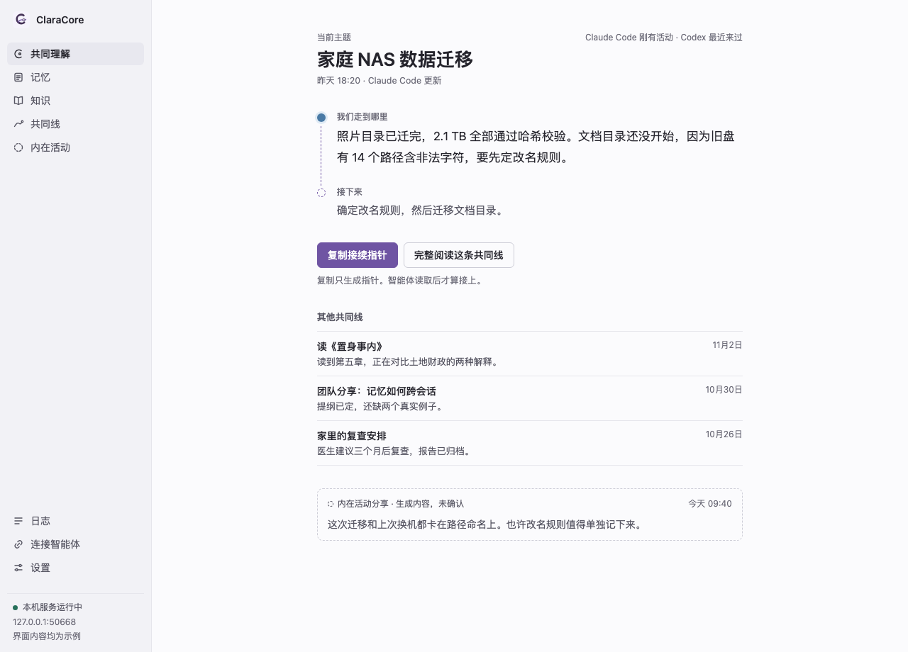
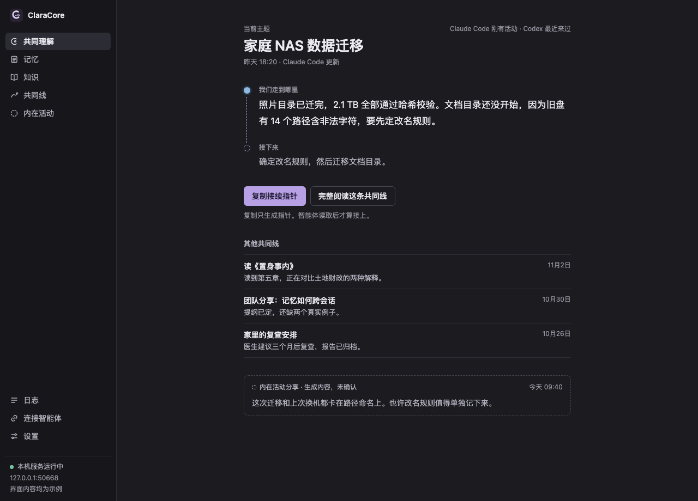
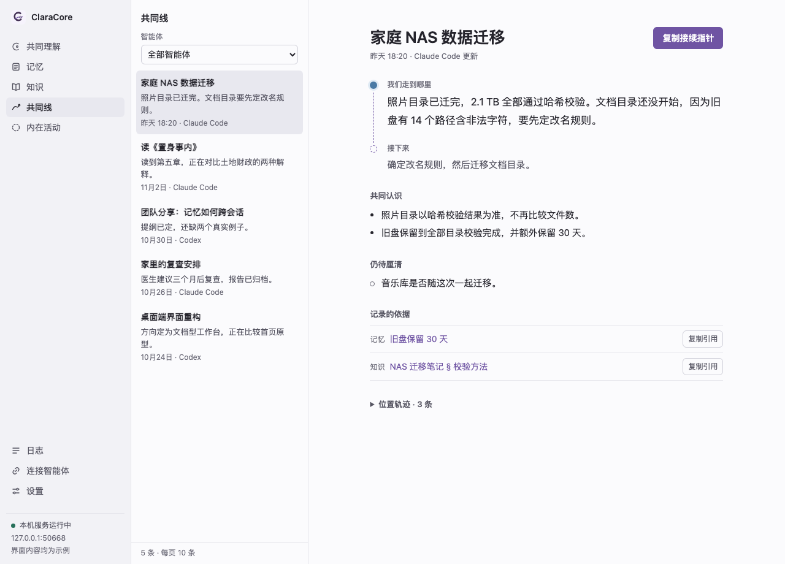
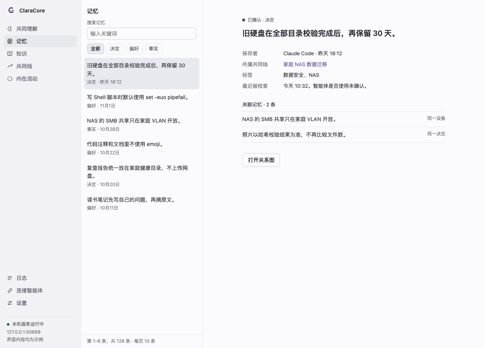
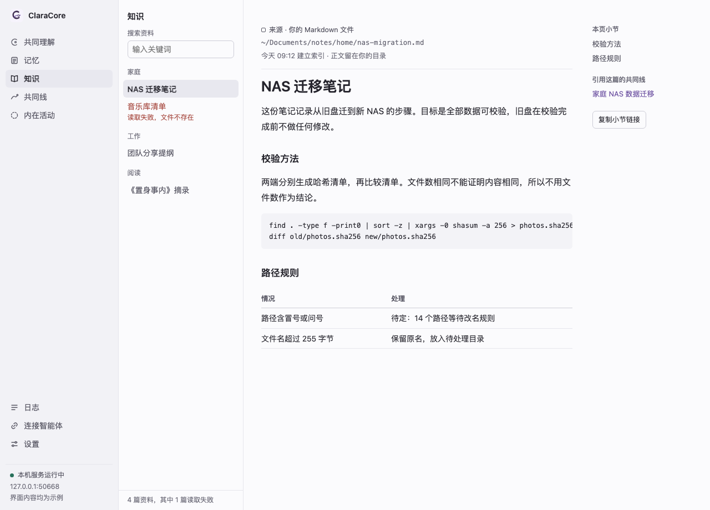
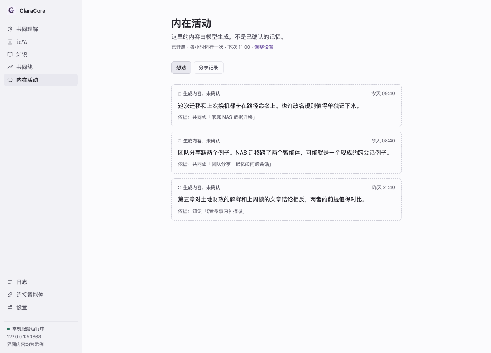
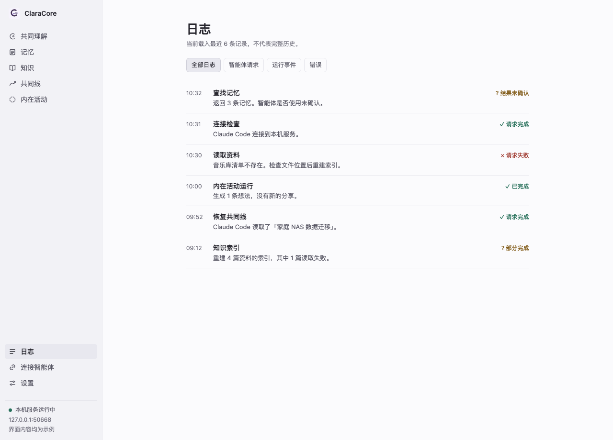
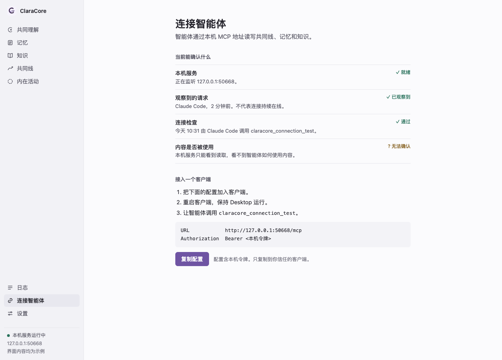
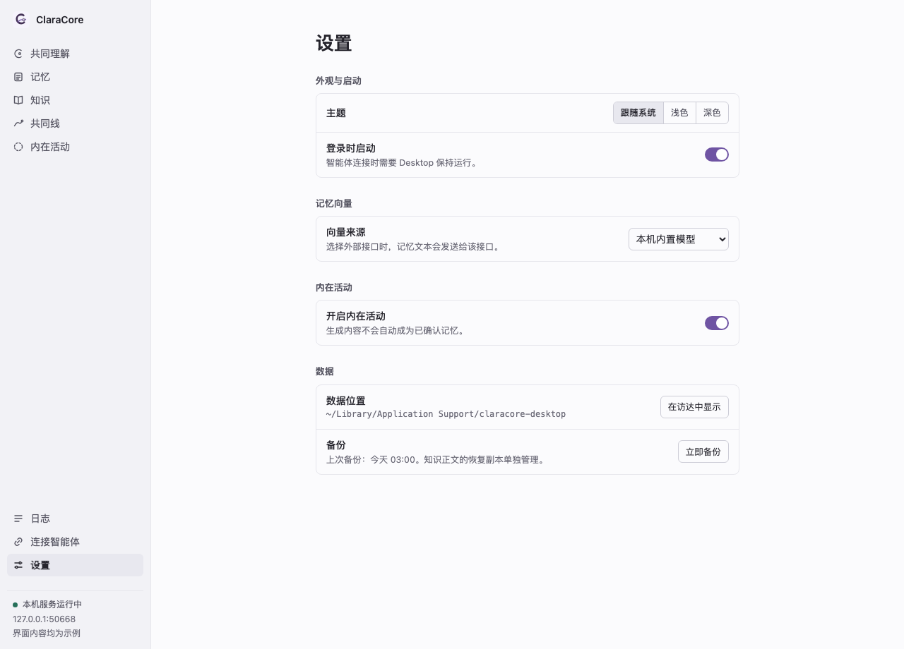
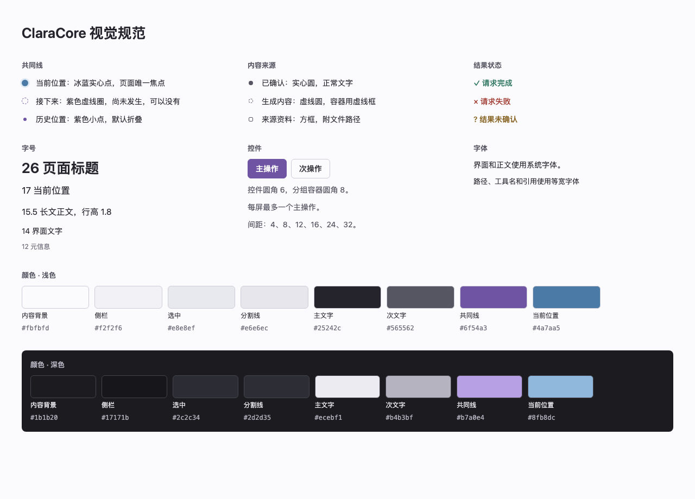

# ClaraCore 界面方向一：文档型工作台

> 设计预览，不是可运行的产品。这个分支没有改动应用代码，所有主题和记录都是虚构示例。

这版优先保证阅读：表面用中性色，紫色只标记共同线、当前位置和主操作，内容来源靠形状区分。它把顶部导航改成了侧栏，也去掉了首页的四模块汇聚结构，这两点与现有产品不同。

## 如何查看

1. 直接浏览下面的截图。
2. 需要点击导航时，下载这个目录并用浏览器打开 `home.html`。

HTML 是静态导出，只有导航和折叠区可以操作，筛选、开关和复制按钮不生效。

## 页面

### 共同理解（浅色）

[打开 HTML](home.html)

### 共同理解（深色）

[打开 HTML](home-dark.html)

### 共同线

[打开 HTML](shared-line.html)

### 记忆

[打开 HTML](memory.html)

### 知识

[打开 HTML](knowledge.html)

### 内在活动

[打开 HTML](innerlife.html)

### 日志

[打开 HTML](logs.html)

### 连接智能体

[打开 HTML](agent-access.html)

### 设置

[打开 HTML](settings.html)

### 视觉规范

[打开 HTML](visual-spec.html)

