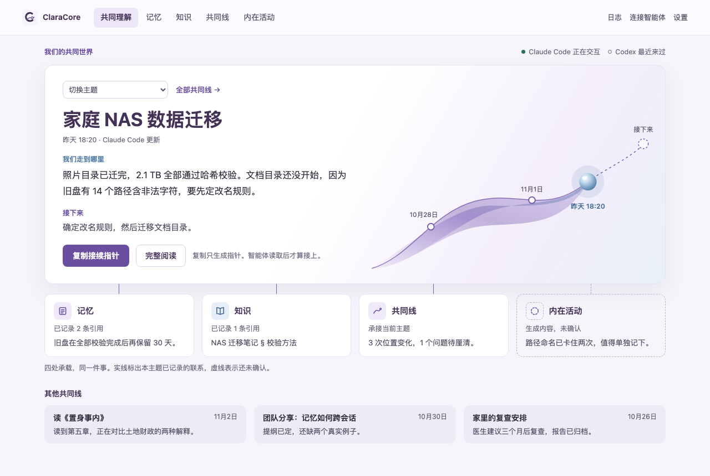
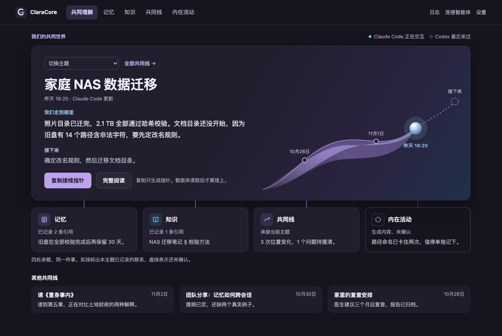
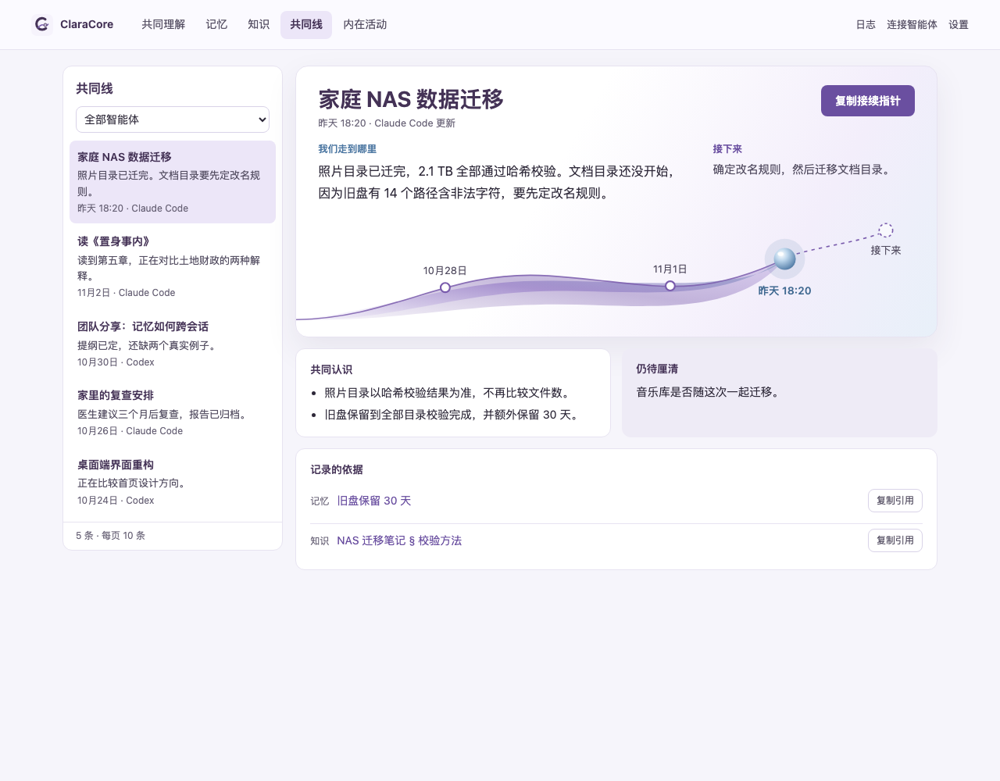
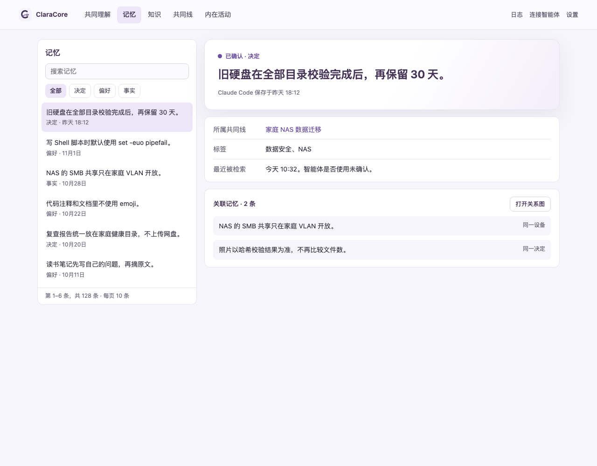
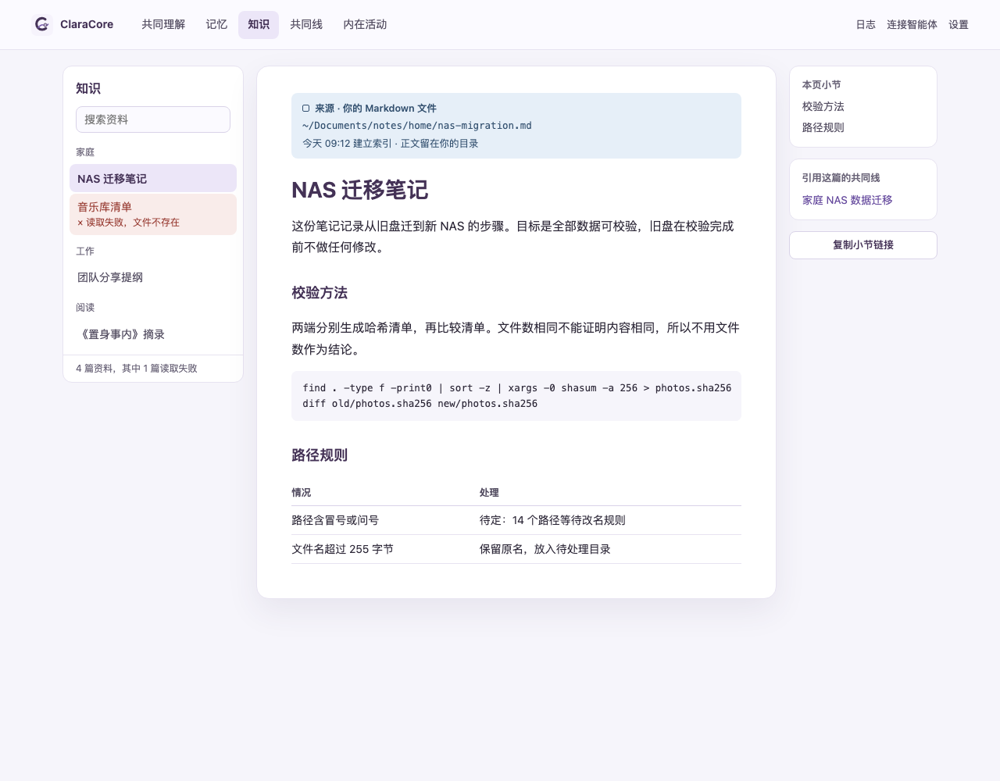
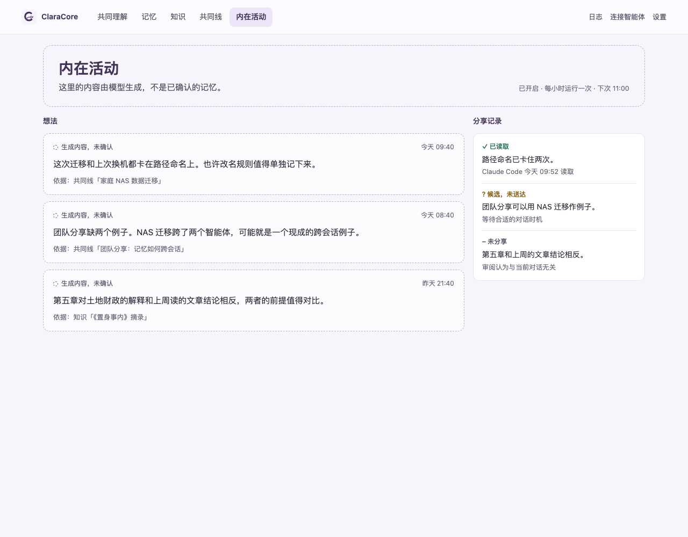

# ClaraCore 界面方向二：共同世界

> 设计预览，不是可运行的产品。这个分支没有改动应用代码，所有主题和记录都是虚构示例。

这版保留现有的顶部导航和首页四模块结构。首页以当前主题和共同线丝带为第一视觉焦点：紫色圆点是历史位置，冰蓝玻璃球是当前位置，虚线圈是接下来。模块连线的实线表示已记录的联系，虚线表示内容还未确认。

这版只画了首页、共同线、记忆、知识和内在活动；日志、连接智能体和设置没有画，深色只画了首页。

## 如何查看

1. 直接浏览下面的截图。
2. 需要点击导航时，下载这个目录并用浏览器打开 `home.html`。

HTML 是静态导出，只有导航可以操作，筛选和复制按钮不生效。

## 页面

### 共同理解（浅色）

[打开 HTML](home.html)

### 共同理解（深色）

[打开 HTML](home-dark.html)

### 共同线

[打开 HTML](shared-line.html)

### 记忆

[打开 HTML](memory.html)

### 知识

[打开 HTML](knowledge.html)

### 内在活动

[打开 HTML](innerlife.html)

